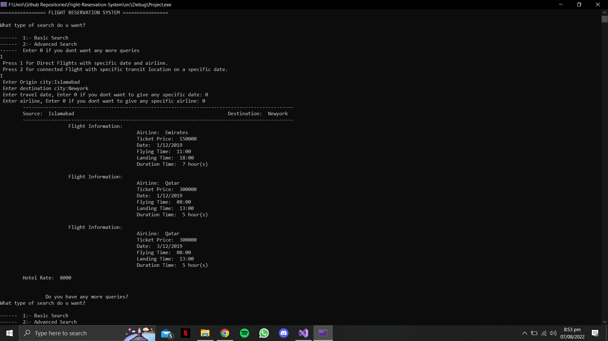
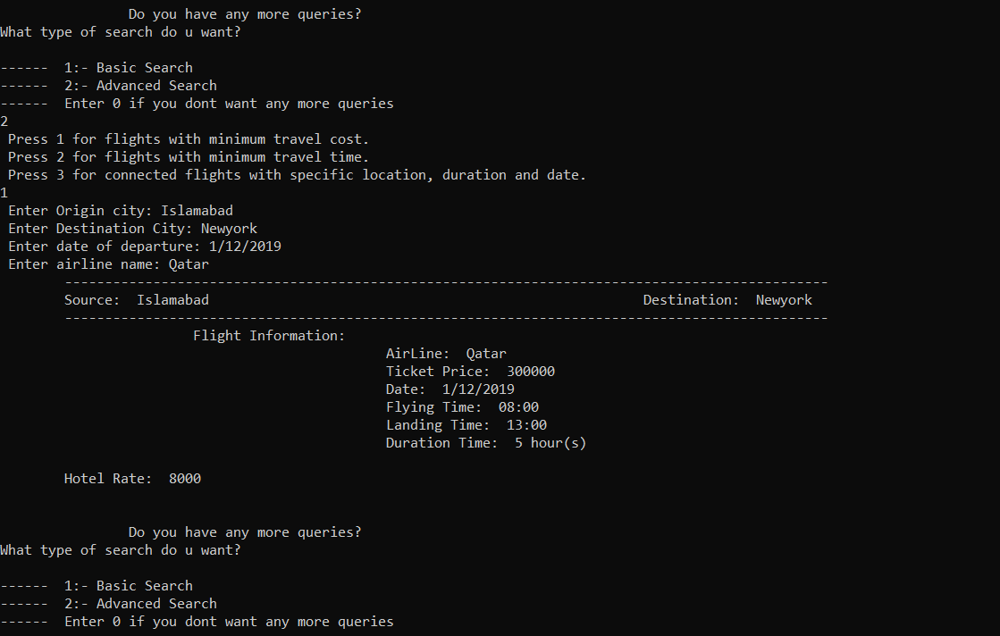

# Airline Reservation System

A console-based C++ airline search and reservation project that models flights as a graph and uses shortest-path techniques to find practical routes by cost or travel time.

[](https://github.com/SameetAsadullah/airline-route-planner/actions/workflows/quality.yml)
[](LICENSE)

## Highlights

- Direct and connected-flight searches
- Dijkstra-style route optimization by ticket cost or travel time
- Filters for departure date and airline
- Hotel charges for layover destinations
- File-backed flight and hotel data
- Custom vector, linked-list, and stack implementations

## Project structure

| Path | Purpose |
|---|---|
| `src/main.cpp` | Application entry point |
| `include/graph.h` | Flight graph, traversal, and optimized-route logic |
| `include/flight.h` | Flight and schedule domain model |
| `include/list.h`, `include/vector.h`, `include/stack.h` | Custom data structures |
| `include/user_interface.h` | Interactive console workflow |
| `data/flights.txt` | Flight schedule input |
| `data/hotel-charges.txt` | Per-city hotel rates |

## Build and run

```bash
make
./build/airline-route-planner
```

Run the executable from the repository root so the bundled data files can be found.

## Input data

Each line in `data/flights.txt` contains the departure city, destination city, departure date, departure and arrival times, ticket price, and airline. `data/hotel-charges.txt` maps layover cities to daily hotel costs. Both files can be edited to explore other networks.

## Screenshots

| Search menu | Route result |
|---|---|
|  |  |

## Project status

The route-planning implementation remains close to its original design, while repository maintenance focuses on portability, documentation, and removal of generated IDE artifacts.

## License

Released under the [MIT License](LICENSE).
